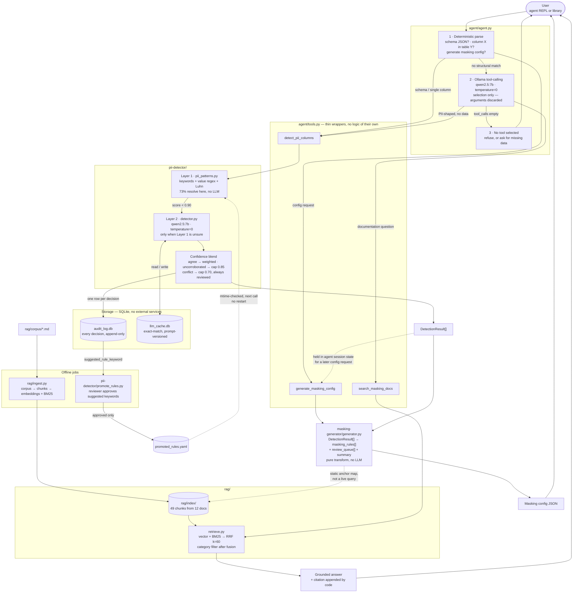

# HLD — Schema Intelligence Assistant

Whole-system view. One conversational entry point, three tools, two storage
layers, two offline jobs. Everything runs on local Ollama.

## Why it is shaped this way

| Decision | Reason |
|---|---|
| Deterministic parse **before** any LLM call | Most requests are structurally decidable. A model adds latency and failure modes, not accuracy. |
| Model picks the tool, code builds the arguments | `qwen2.5` selects reliably but fabricates arguments — asked about one column it invented a five-column schema. |
| Rule layer first, LLM only when unsure | Cost tracks schema *ambiguity*, not schema *size*. |
| Conflict capped at 0.70, below the 0.80 auto bar | Rule/LLM disagreement can never auto-configure. |
| Promotion needs a human | An unreviewed suggestion entering the deterministic layer destroys the property that layer exists for. |
| Everything to SQLite | "Why was this column masked?" must be answerable months later. |

## Model and cost profile

| Component | Model | When it runs |
|---|---|---|
| Rule engine | none | every column |
| Detector Layer 2 | `qwen2.5:7b` | only unresolved columns, cached |
| Agent tool selection | `qwen2.5:7b` | only structurally ambiguous messages |
| Agent answer generation | `qwen2.5:7b` | documentation questions only |
| Embeddings | `nomic-embed-text` | ingest, and once per RAG query |

`qwen2.5:14b` was the original agent choice and was reversed on measured
evidence — see `agent/tests/ab_baseline_results.md`.
