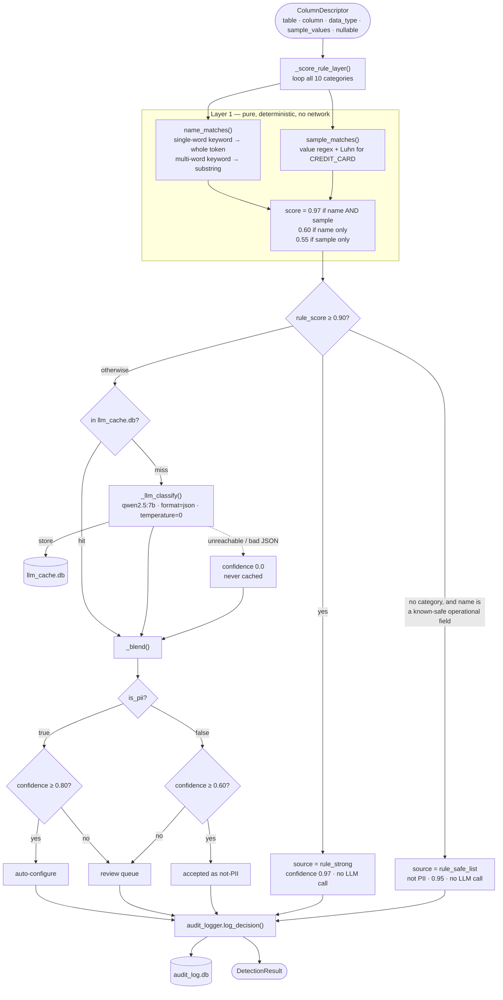
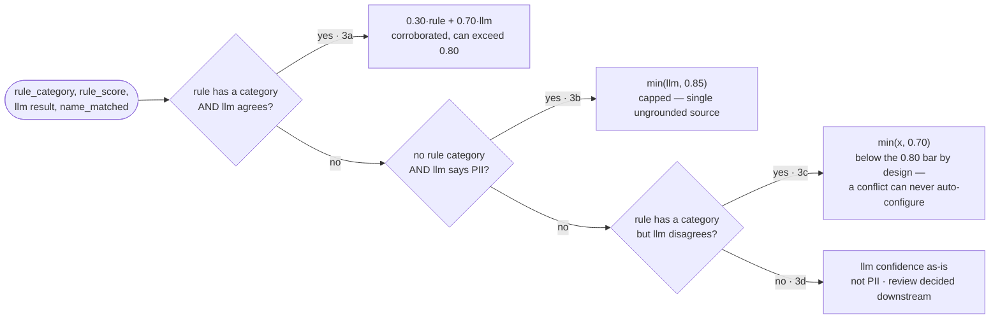

# LLD — PII Detector

`pii-detector/` · one column in, one `DetectionResult` out.

## Decision flow



## Confidence blend — the four branches of `_blend()`



**Two thresholds, not one scale.** `is_pii` is settled first from the signals;
confidence is then checked against a different bar depending on the answer —
0.80 for PII, 0.60 for not-PII. Confidence never flips the verdict. The
not-PII floor is deliberately beyond the task's literal contract: an
ungrounded low-confidence "not PII", with no rule opinion to cross-check it,
is the exact shape of a compliance miss.

## Self-improving loop — human-gated, never automatic

```mermaid
sequenceDiagram
    participant D as detector.py
    participant A as audit_log.db
    participant R as Reviewer
    participant Y as promoted_rules.yaml
    participant P as pii_patterns.py

    D->>D: PII found, name dictionary missed it
    Note over D: gated twice — llm said PII<br/>AND name_matched is false
    D->>A: log decision + suggested_rule_keyword
    R->>A: promote_rules.py — group by (category, keyword),<br/>count distinct columns, drop ones already known
    A-->>R: pending candidates + examples
    R->>Y: approve (y/n per candidate)
    P->>Y: get_promoted_keywords() — mtime check
    Note over P,Y: re-parsed only when the file changes;<br/>picked up on the very next detect(), no restart
    P->>D: merged over POSITIVE_NAME_KEYWORDS<br/>base dictionary never edited
```

Verified end to end on real data: the model proposed `elektropost` for a
column holding obfuscated email addresses, a reviewer approved it, and the
next process resolved that column at Layer 1 — `rule_strong`, 0.97, no LLM
call. A column that cost a model call became free.

## Contracts

```
INPUT  ColumnDescriptor          OUTPUT  DetectionResult
  table_name    str                table                          str
  column_name   str                column                         str
  data_type     str | None         is_pii                         bool
  sample_values list[str]          confidence                     float
  nullable      bool | None        pii_category                   str | None
                                   recommended_masking_function   str | None
                                   review_required                bool
                                   reasoning                      str
                                   alternative_category           str | None
```

`alternative_category` is set **only** in branch 3c — the losing side of a
real, evidence-backed disagreement, never a guess. It becomes the review
queue's `alternatives[]`. It holds at most one value, because the system only
ever has two opinions.

## Constants

| Name | Value | Role |
|---|---|---|
| `RULE_ALONE_THRESHOLD` | 0.90 | at or above, skip the LLM entirely |
| `AUTO_CONFIGURE_THRESHOLD` | 0.80 | PII at or above auto-configures |
| `NEGATIVE_REVIEW_FLOOR` | 0.60 | not-PII below this is still reviewed |
| `NO_CORROBORATION_CAP` | 0.85 | ceiling for a single ungrounded source |
| `CONFLICT_CAP` | 0.70 | deliberately below the auto bar |

Thresholds and model are env-overridable; the caps are structural.

## Measured — 30-column golden set

| Metric | Target | Measured |
|---|---|---|
| Recall | ≥ 0.90 | **1.00** |
| Precision | ≥ 0.70 | **0.79** |
| Auto-config rate (of true positives) | ≥ 0.80 | **0.93** |
| Category accuracy | — | **1.00** |
| Layer 1 resolution | — | 22/30 (73%) |

All four targets are asserted by tests, not just reported. Two cold-cache
runs produce byte-identical results across all 30 columns.
