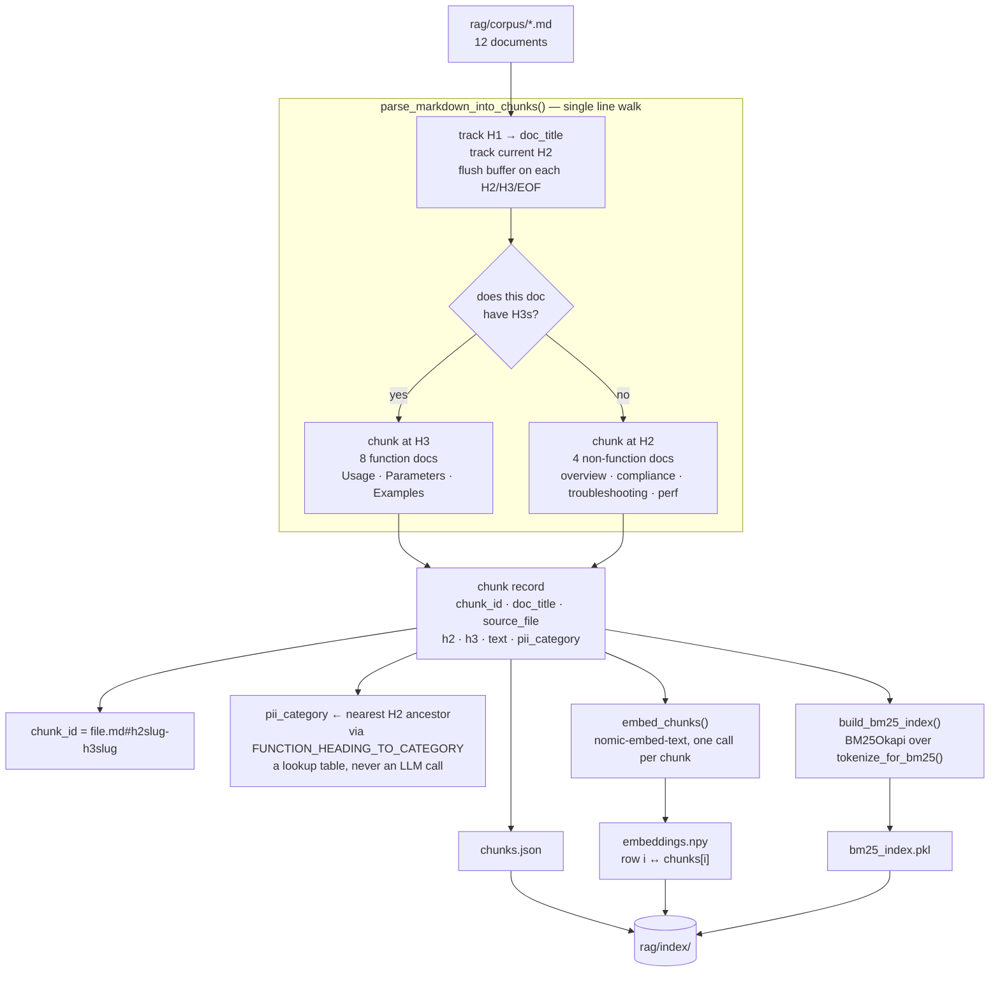
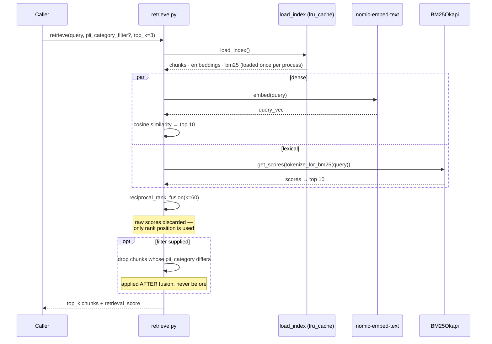

# LLD — RAG Documentation Pipeline

`rag/` · offline build, online query. 12 markdown documents → 49 chunks.

## Ingestion — offline, re-run on corpus change



**Why `chunk_id` combines H2 and H3.** Three documents cover more than one
masking function, and each repeats `Usage` / `Parameters` / `Examples` under
a different H2. An H3-only anchor would collide —
`phone_ssn_mask.md#usage` would be ambiguous between PHONE and SSN. Combining
them gives `#phone_mask-usage` and `#ssn_mask-usage`, and the same string
doubles as the `documentation_reference` the masking generator emits.

**Two contracts that will break silently if violated:**

- `embeddings.npy` row *i* must stay aligned with `chunks[i]` — there is no
  id column to fall back on.
- `tokenize_for_bm25()` is imported by `retrieve.py`, never duplicated. An
  index built with one tokenizer and queried with another produces scores
  that look plausible and mean nothing.

## Retrieval — online, per query



## Reciprocal Rank Fusion

Cosine similarity lives on 0–1; BM25 is unbounded. Averaging them requires
normalising two incomparable scales. RRF sidesteps that by throwing the
scores away and using only rank position:

```
score(chunk) = Σ  1 / (k + rank_in_that_list)      k = 60
```

`k = 60` is the constant from the original paper, deliberately **not** tuned
here — fitting it to a 10-query eval set would optimise the metric rather
than the retrieval. Its effect is to flatten the top of each list: rank 1 vs
rank 2 is a ~2% difference, while appearing in both lists at all is what
dominates. A chunk that is decent on both signals beats one that tops a
single list and is absent from the other.

**Filter after fusion, not before.** Filtering the candidate pool first would
let a query win by elimination — with only EMAIL chunks in play, retrieving an
EMAIL chunk proves nothing. Post-fusion, the ranking has to be right first,
and the filter is a scoping tool for a caller that already knows the category.

## Index artifacts

| File | Contents | Notes |
|---|---|---|
| `chunks.json` | 49 records | the only place chunk text and metadata live |
| `embeddings.npy` | (49, 768) float32 | index-aligned with `chunks.json` |
| `bm25_index.pkl` | pickled `BM25Okapi` | rebuilt wholesale, never incrementally |

All three are gitignored — build artifacts, regenerated by
`python rag/ingest.py`. `load_index` is `lru_cache`d per process and does not
watch for changes: re-ingesting requires a restart to take effect.

## Measured — 10-query eval set

| Metric | Target | Measured |
|---|---|---|
| Recall@3, document level | ≥ 0.70 | **1.00** (10/10) |

Read as *"hybrid retrieval works"*, not *"retrieval is solved"*. The corpus
and the queries were written with knowledge of each other, and ranking third
out of twelve documents is an easier bar than a production corpus. One known
weakness left untuned: `"what parameters does EMAIL_MASK accept"` retrieves
the right document but `masking_functions_overview.md` out-ranks the target's
own `#parameters` chunk on term overlap.
